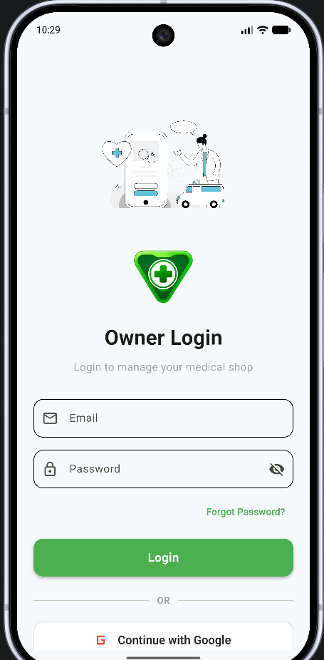
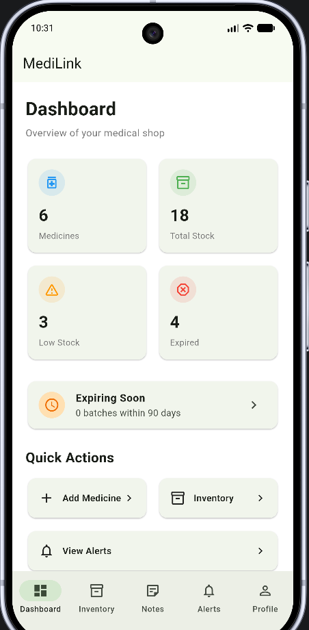

# 💊 MediLink

<p align="center">
  <b>A Flutter-Based Medical Shop Management Application</b>
</p>

<p align="center">
  A Smart, Offline-First Solution for Medical Shop Management
</p>

---

## 📖 About

**MediLink** is a Flutter-based medical shop management application designed to simplify the daily operations of an individual medical shop.

It provides a centralized platform for managing medicine inventory, tracking batches and expiry dates, monitoring stock levels, maintaining customer records, recording payments, and organizing daily shop notes.

MediLink follows a **single-store owner management model**, focusing on practical functionality, reliable data management, offline accessibility, and a clean user experience.

The application uses Flutter, Firebase Authentication, and Hive local storage.

---

## 📸 Application Screenshots

### Login Screen

<p align="center">
  
</p>

### Main Dashboard

<p align="center">
  
</p>

---

## 🎯 Project Objectives

- Simplify medicine inventory management.
- Maintain medicine and batch-wise stock records.
- Track medicine expiry dates.
- Monitor low-stock and out-of-stock medicines.
- Maintain regular customer information.
- Record frequently purchased medicines.
- Manage customer payment records and outstanding balances.
- Maintain daily shop notes.
- Provide offline access to essential inventory information.

---

## ✨ Features

### 1. Application Foundation

- Flutter application architecture.
- Material Design 3 theme.
- Custom application branding and logo.
- Animated splash screen using Lottie.
- Login and registration flow.
- Main application navigation.
- Firebase Authentication integration.

### 2. Dashboard

- Dashboard overview.
- Medicine and inventory summary.
- Store information overview.

### 3. Medicine & Inventory Management

- Add, edit, and delete medicines.
- Medicine search.
- Medicine information management.
- Batch-wise inventory structure.
- Stock tracking.
- Low-stock monitoring.
- Out-of-stock monitoring.
- Medicine expiry tracking.

### 4. Alerts

- Low-stock alerts.
- Out-of-stock monitoring.
- Medicine expiry alert categories.
- 30-day, 60-day, and 90-day expiry monitoring.

### 5. Shop Profile

- Shop profile management.
- Store information management.

### 6. Daily Notes

- Add notes.
- Edit notes.
- Delete notes.
- Hive-based persistence.
- Reactive note list updates.

### 7. Regular Customers

- Add customer information.
- Edit customer information.
- Delete customer records.
- Customer search.
- Reactive customer list updates.
- Customer-specific medicine records.

### 8. Customer Payment Management

- Add payment records.
- Edit payment records.
- Delete payment records.
- Payment status tracking.
- Total, paid, and remaining amount summaries.
- Outstanding balance calculation.
- Payment data validation.

### 9. Data Management

- CSV import and export.
- Application backup.
- Backup restoration.
- Local data persistence using Hive.

---

## 🛠️ Technology Stack

| Technology | Purpose |
|---|---|
| Flutter | Application development |
| Dart | Programming language |
| Firebase Authentication | Owner authentication |
| Hive | Local database |
| Material Design 3 | User interface |
| Lottie | Animations |
| Git | Version control |
| GitHub | Source code management |

---

## 🗄️ Data Management

MediLink uses Firebase Authentication alongside Hive local storage.

### Firebase Authentication

Used for owner account registration, login, and authentication.

### Hive Local Storage

Used to store application information, including:

- Medicine information.
- Medicine batches.
- Stock information.
- Expiry-related records.
- Shop profile information.
- Daily notes.
- Regular customer records.
- Customer medicine records.
- Customer payment records.

The application follows an **offline-first approach**, allowing essential medicine and inventory information to remain accessible locally.

---

## 🏗️ Application Modules

| Module | Functionality |
|---|---|
| Authentication | Owner login and registration |
| Dashboard | Overview of store information |
| Inventory | Medicine and stock management |
| Alerts | Expiry and stock monitoring |
| Daily Notes | Store-related notes |
| Regular Customers | Customer information |
| Customer Medicines | Customer-specific medicine records |
| Payment Management | Customer payment records and balances |
| Profile | Shop information |
| Backup & Restore | Local application data backup and restoration |

---

## 🔮 Future Improvements

The following enhancements can further improve MediLink:

- [ ] Push notifications for medicine expiry and low-stock alerts.
- [ ] Enhanced dashboard with additional inventory insights.
- [ ] Advanced medicine search and filtering.
- [ ] Improved backup and restoration options.
- [ ] Enhanced application security.
- [ ] Additional data validation and integrity checks.
- [ ] UI/UX improvements and accessibility enhancements.
- [ ] Performance optimization.
- [ ] Comprehensive application testing.
- [ ] Production-ready Android release.

---

## 🧪 Testing & Quality

Important application testing areas include:

- Form validation.
- Medicine and batch data consistency.
- Hive database operations.
- Customer record management.
- Payment calculations.
- Outstanding balance accuracy.
- Reactive UI updates.
- Expiry and stock alert accuracy.
- Backup and restoration.
- Application stability.

Static analysis can be performed using:

```bash
flutter analyze
```

---

## 💻 Getting Started

### Prerequisites

- Flutter SDK.
- Dart SDK.
- Android Studio or Visual Studio Code.
- Android SDK.
- Firebase project configuration.

### Installation

**1. Clone the repository**

```bash
git clone https://github.com/Pranay-Pandurang-Patil/medilink.git
```

**2. Navigate to the project directory**

```bash
cd medilink
```

**3. Install dependencies**

```bash
flutter pub get
```

**4. Configure Firebase**

Configure the required Firebase project and platform-specific authentication settings.

**5. Run the application**

```bash
flutter run
```

> **Note:** This is a public showcase repository. Selected production implementation, configuration files, and business logic are intentionally excluded. Therefore, this repository may not be independently runnable.

---

## 👨‍💻 Developer

**Pranay Patil**

Computer Science Engineering Student

GitHub: [Pranay-Pandurang-Patil](https://github.com/Pranay-Pandurang-Patil)

---

## 🤝 Contributions & Feedback

MediLink is an individual portfolio project.

Suggestions and constructive feedback are welcome. However, permission must be obtained before using or reproducing any part of the project.

---

## 📜 License & Copyright

© 2026 Pranay Patil. All rights reserved.

**MediLink is a proprietary software and portfolio project.**

This public repository is provided for portfolio presentation, educational review, and project evaluation purposes only.

### Unauthorized Use Prohibited

Without prior written permission from the author, no individual, organization, or third party is permitted to:

- Copy, reproduce, or redistribute the source code.
- Reuse, modify, or republish the original implementation.
- Copy or reuse project assets, branding, logos, or designs.
- Publish this project or substantial portions of it as their own work.
- Create derivative applications using the original implementation.
- Use any part of the project for commercial purposes.
- Remove or modify copyright and ownership notices.

**Public availability does not grant permission to copy, reuse, modify, distribute, or commercially exploit this project.**

All rights to the original implementation, project structure, branding, and assets remain with the author.

For permissions or licensing inquiries, contact the author through GitHub.

See the [LICENSE](LICENSE) file for additional terms.

> **Public Showcase Notice:** This repository represents the public showcase version of MediLink. Selected production implementation, configuration files, and business logic are intentionally excluded. The complete project implementation is maintained in a private repository.

---

## ⭐ Support

If you find MediLink interesting, consider giving the repository a ⭐ on GitHub.

Your support is appreciated!
